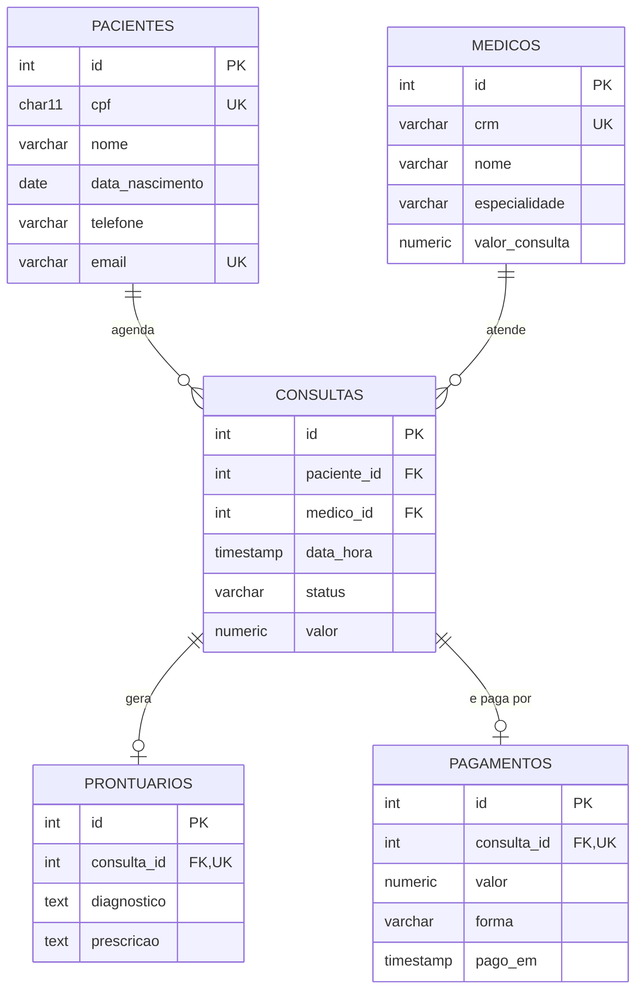

# Clínica Médica: Escopo Inicial e Decisão Tecnológica

Projeto final da disciplina **Modelagem de Banco de Dados**: banco de dados de um sistema de **agendamento e atendimento de uma clínica médica**.

```
clinica-medica-db/
├── docs/
│   └── DER.md                    # Diagrama Entidade-Relacionamento
├── database/
│   ├── 00_create_database.sql    # cria o banco clinica_medica
│   ├── init.sql                  # tabelas, regras de negócio e dados de exemplo
│   └── tests.sql                 # testes que provam as regras de negócio
├── src/                          # código da aplicação (próximas etapas)
└── .github/workflows/
    └── validar-banco.yml         # roda os scripts em um PostgreSQL a cada push
```

---

## Parte 1: Formação e definição do escopo

### Integrante

| Nome | GitHub |
|---|---|
| Marcio Rogério Reis Freire Junior | [@marciowsz](https://github.com/marciowsz) |

### Tema

**Sistema de Clínica Médica.** O sistema gerencia o cadastro de pacientes e médicos, o agendamento de consultas, o registro do atendimento (prontuário) e o pagamento.

### Escopo desta fase

Para evitar o *scope creep*, a primeira versão cobre só o fluxo principal: **agendar, atender e receber**.

| Dentro do escopo | Fora do escopo (versões futuras) |
|---|---|
| Cadastro de pacientes e médicos | Integração com planos de saúde (TISS) |
| Agendamento, cancelamento e agenda do médico | Telemedicina / videochamada |
| Prontuário da consulta | Estoque de medicamentos e materiais |
| Registro de pagamento | Emissão de nota fiscal |
| Histórico do paciente | Exames laboratoriais e laudos |

### Requisitos funcionais

| ID | Requisito |
|---|---|
| **RF01** | O sistema deve permitir **cadastrar pacientes** com nome, CPF, data de nascimento, telefone e e-mail, sem permitir CPF repetido. |
| **RF02** | O sistema deve permitir **cadastrar médicos** com nome, CRM, especialidade e valor da consulta. |
| **RF03** | O sistema deve permitir **agendar consultas**, impedindo que um médico ou um paciente tenha duas consultas no mesmo horário. |
| **RF04** | O sistema deve permitir **cancelar uma consulta**, liberando o horário para outro paciente. |
| **RF05** | O sistema deve permitir **registrar o prontuário** (diagnóstico, prescrição, observações) de uma consulta realizada. |
| **RF06** | O sistema deve permitir **registrar o pagamento** de uma consulta (PIX, cartão, dinheiro ou convênio), uma única vez por consulta. |
| **RF07** | O sistema deve exibir a **agenda do dia** de cada médico. |
| **RF08** | O sistema deve exibir o **histórico de consultas e prontuários** de um paciente. |

### Requisitos não-funcionais

| ID | Requisito |
|---|---|
| **RNF01** | **Consistência:** os dados de agendamento e pagamento devem ser altamente consistentes. Nunca pode haver dois pacientes no mesmo horário de um médico nem pagamento duplicado, mesmo com acessos simultâneos. |
| **RNF02** | **Segurança e LGPD:** dados de saúde são dados pessoais sensíveis (LGPD, art. 11). O acesso ao prontuário deve ser restrito a médicos autenticados e todo acesso deve ser registrado. |
| **RNF03** | **Desempenho:** a agenda do dia e o histórico do paciente devem carregar em menos de 1 segundo com até 100 mil consultas cadastradas. |
| **RNF04** | **Disponibilidade e backup:** disponibilidade de 99% em horário comercial, com backup diário e retenção mínima de 30 dias. |

---

## Parte 2: Entidades e decisão tecnológica

### Entidades principais

| Entidade | Descrição | Relacionamentos |
|---|---|---|
| **Paciente** | Pessoa atendida pela clínica. Identificada pelo CPF (único). | Tem **várias consultas** (1:N). |
| **Médico** | Profissional que realiza o atendimento. Identificado pelo CRM (único); tem especialidade e valor de consulta. | Atende **várias consultas** (1:N). |
| **Consulta** | Agendamento de um paciente com um médico em uma data/hora, com status (`AGENDADA`, `REALIZADA`, `CANCELADA`). É a entidade central e liga paciente e médico (resolve o N:N). | Pertence a **1 paciente** e **1 médico**; pode ter **1 prontuário** e **1 pagamento**. |
| **Prontuário** | Registro clínico de uma consulta realizada: diagnóstico, prescrição e observações. | Pertence a **exatamente 1 consulta** (1:0..1). |
| **Pagamento** | Valor recebido por uma consulta e a forma de pagamento. | Pertence a **exatamente 1 consulta** (1:0..1). |

O diagrama completo está em [docs/DER.md](docs/DER.md) e também na Parte 3.

### Decisão tecnológica: **PostgreSQL (relacional)**

### Justificativa

Escolhemos o **PostgreSQL** porque os dados de uma clínica são **fortemente relacionados e têm estrutura estável**. Toda consulta liga obrigatoriamente um paciente a um médico, e prontuário e pagamento só existem a partir de uma consulta. Esse é exatamente o cenário que **chaves estrangeiras e JOINs** resolvem bem.

O requisito mais crítico do sistema (RNF01) é a **consistência**: dois pacientes não podem ser marcados no mesmo horário do mesmo médico, e uma consulta não pode ser paga duas vezes. No PostgreSQL essas regras são garantidas **pelo próprio banco**, com transações **ACID**, `UNIQUE`, `CHECK` e `FOREIGN KEY`. Se duas recepcionistas tentarem marcar o mesmo horário ao mesmo tempo, o banco aceita apenas uma, independentemente de bugs na aplicação.

Além disso:
- **Dados sensíveis (LGPD):** o PostgreSQL oferece controle de acesso por papéis (roles), *Row-Level Security* e criptografia, o que é importante para o prontuário.
- **Relatórios:** consultas como agenda do dia, faturamento por médico e histórico do paciente são naturalmente escritas em SQL.
- **Custo:** é gratuito, de código aberto e disponível em todos os provedores de nuvem.

**Por que não MongoDB?** O ponto forte do MongoDB é a flexibilidade de esquema, e aqui ela não é necessária: todo paciente tem os mesmos campos, assim como toda consulta e todo pagamento. Em troca, perderíamos a garantia nativa de integridade entre coleções. Seria preciso validar na aplicação que o médico da consulta existe e que o horário está livre, o que é exatamente o tipo de regra que não pode falhar neste sistema.

**Evolução:** se no futuro o prontuário precisar guardar dados muito variados por especialidade (sinais vitais, medidas oftalmológicas, odontograma), o PostgreSQL permite usar uma coluna `JSONB` só nessa parte, sem precisar de um segundo banco.

---

## Parte 3: Desafio

### Diagrama Entidade-Relacionamento (DER)



### Script inicial

- [`database/00_create_database.sql`](database/00_create_database.sql) cria o banco `clinica_medica`.
- [`database/init.sql`](database/init.sql) cria a tabela principal `pacientes` e as demais (`medicos`, `consultas`, `prontuarios`, `pagamentos`), insere dados de exemplo e traz consultas prontas (agenda do dia, histórico do paciente, faturamento por médico).

```bash
psql -U postgres -f database/00_create_database.sql
psql -U postgres -d clinica_medica -f database/init.sql
psql -U postgres -d clinica_medica -v ON_ERROR_STOP=1 -f database/tests.sql
```

Com Docker:

```bash
docker run -d --name clinica-pg -e POSTGRES_PASSWORD=postgres -p 5432:5432 postgres:16
docker exec -i clinica-pg psql -U postgres                    < database/00_create_database.sql
docker exec -i clinica-pg psql -U postgres -d clinica_medica  < database/init.sql
docker exec -i clinica-pg psql -U postgres -d clinica_medica  < database/tests.sql
```

### Bônus: regras de negócio garantidas pelo banco

| Regra | Como é garantida |
|---|---|
| Preço da consulta nunca é negativo nem zero | `CHECK (valor_consulta > 0)` em `medicos`; `CHECK (valor > 0)` em `pagamentos` |
| Médico não atende dois pacientes no mesmo horário | Índice único parcial `(medico_id, data_hora) WHERE status <> 'CANCELADA'` |
| Paciente não fica em duas consultas ao mesmo tempo | Índice único parcial `(paciente_id, data_hora) WHERE status <> 'CANCELADA'` |
| Consulta cancelada libera o horário | Os índices acima ignoram `status = 'CANCELADA'` |
| Agenda em horários de 30 minutos | `CHECK (EXTRACT(MINUTE FROM data_hora) IN (0, 30))` |
| CPF válido e único | `CHECK (cpf ~ '^[0-9]{11}$')` + `UNIQUE` |
| Status só com valores permitidos | `CHECK (status IN ('AGENDADA','REALIZADA','CANCELADA'))` |
| Uma consulta é paga uma única vez | `pagamentos.consulta_id UNIQUE` |
| Consulta sempre de paciente e médico existentes | `FOREIGN KEY` |

O arquivo [`database/tests.sql`](database/tests.sql) tenta gravar **dados inválidos** para cada regra e confirma que o banco recusa. O workflow [`validar-banco.yml`](.github/workflows/validar-banco.yml) roda os scripts em um PostgreSQL real a cada push. Resultado esperado:

```
NOTICE:  OK 1: valor_consulta negativo recusado
NOTICE:  OK 2: horario duplicado do medico recusado
NOTICE:  OK 3: horario cancelado foi reaproveitado
NOTICE:  OK 4: horario fora da grade recusado
NOTICE:  OK 5: CPF invalido recusado
NOTICE:  OK 6: CPF duplicado recusado
NOTICE:  OK 7: paciente inexistente recusado
NOTICE:  OK 8: pagamento duplicado recusado
NOTICE:  OK 9: status invalido recusado
NOTICE:  OK 10: dados de exemplo conferem
```

---

## Parte 4: Reflexão

### Por que a escolha do SGBD (relacional × NoSQL) deve ser feita com base nos requisitos de acesso aos dados e não na preferência da equipe? Qual o impacto de uma escolha errada no início do projeto?

O banco de dados é a **fundação** do sistema: todo o código, as consultas e as regras de negócio são construídos em cima dele. Por isso a escolha precisa partir das **perguntas que o sistema vai fazer aos dados**: como os dados se relacionam, qual o nível de consistência exigido, se a estrutura é fixa ou varia muito, qual o volume e o padrão de leitura e escrita. Não deve partir de "o time já sabe MongoDB" ou "SQL é mais moderno/antigo". A preferência da equipe resolve o conforto de hoje. Os requisitos determinam se o sistema vai funcionar amanhã.

Cada modelo foi criado para um tipo de problema. O **relacional** brilha quando os dados são ligados entre si e a consistência é obrigatória (pagamentos, agendamentos, estoque). O **NoSQL de documentos** brilha quando a estrutura varia muito ou o dado é lido sempre "inteiro" (catálogos, perfis, logs). Na nossa clínica, o requisito "nunca dois pacientes no mesmo horário" aponta diretamente para um banco com transações ACID e restrições de unicidade.

Uma escolha errada no início tem um custo que **cresce com o tempo**:
- **Gargalos de performance:** usar um banco de documentos para dados muito relacionados obriga a fazer "JOINs" na aplicação, com várias idas ao banco por tela. Usar um relacional rígido para dados muito variáveis gera tabelas com dezenas de colunas nulas e consultas lentas.
- **Dificuldade de modelagem e bugs:** regras que o banco deveria garantir (unicidade, integridade referencial, saldo não negativo) passam a depender do código. Basta um bug ou duas requisições simultâneas para gerar dados inconsistentes, como consultas duplicadas ou pagamentos órfãos, que são difíceis de detectar e corrigir.
- **Custos desnecessários de infraestrutura:** para compensar a escolha errada, a equipe adiciona cache, filas, servidores maiores e rotinas de correção de dados, gastando dinheiro para contornar um problema de arquitetura.
- **Migração cara:** trocar de banco com o sistema em produção significa reescrever modelos, consultas e testes, além de migrar dados sem parar a operação. Muitas vezes custa mais do que construir o sistema certo desde o começo.

Por isso a decisão deve ser **técnica, justificada e documentada**, como neste README. Decidir com base em requisitos custa algumas horas de análise no início. Decidir por preferência pode custar meses de retrabalho no fim do semestre, ou do projeto.
