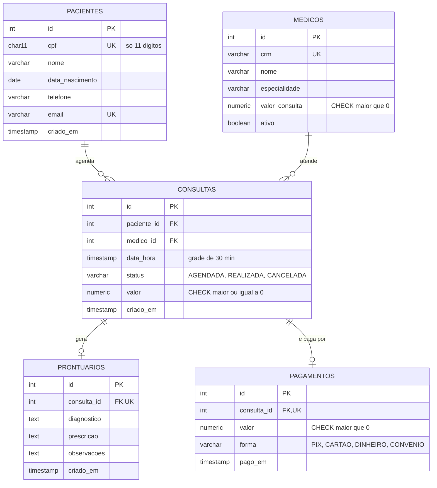

# Diagrama Entidade-Relacionamento (DER)

## Cardinalidades

| Relacionamento | Cardinalidade | Leitura |
|---|---|---|
| Paciente → Consulta | 1 : N | Um paciente pode ter várias consultas; cada consulta é de um único paciente. |
| Médico → Consulta | 1 : N | Um médico atende várias consultas; cada consulta tem um único médico. |
| Consulta → Prontuário | 1 : 0..1 | Só a consulta **realizada** gera prontuário, e no máximo um (`consulta_id UNIQUE`). |
| Consulta → Pagamento | 1 : 0..1 | Uma consulta é paga no máximo uma vez (`consulta_id UNIQUE`). |

**Consultas** é a entidade associativa que resolve o relacionamento N:N entre **Pacientes** e **Médicos**.
